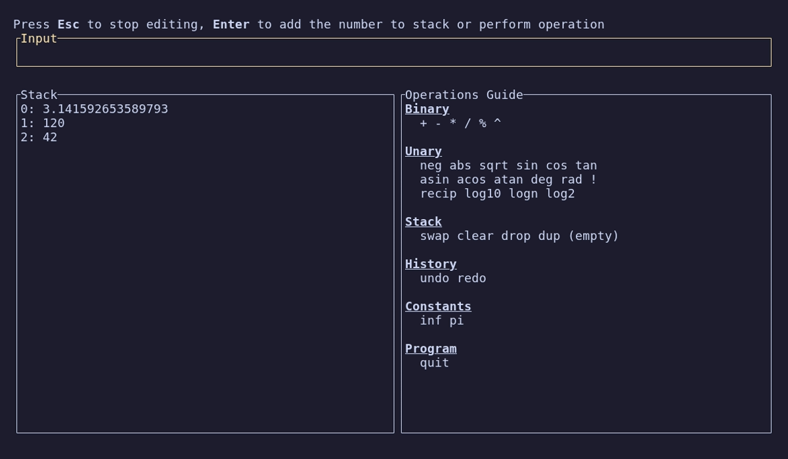

# rpn-calc

A Reverse Polish Notation calculator for the terminal, for people who'd rather type `3 7 +` than reach for a GUI calculator. Built in Rust with ratatui.

<!-- Screenshot: see the note below this README for what to capture. -->


There's no live demo: it's a terminal app, so you run it locally (see [Getting started](#getting-started)).

## What it does

- Type a number and press Enter to push it, or type an operation and press Enter to apply it to the stack.
- Binary operations: `+ - * / % ^`.
- Unary operations: `neg abs sqrt`, trig (`sin cos tan asin acos atan`), `deg`/`rad` conversion, `!`, `recip`, `log10 logn log2`.
- Stack commands: `swap`, `drop`, `clear`, and Enter on an empty line to duplicate the top value.
- `undo` and `redo` for any change to the stack.
- Constants `pi` and `inf`.
- An Operations Guide panel next to the stack lists every command by category, so you don't need to memorise them.
- The stack is saved to `stack.txt` after every command and reloaded on start, so your work survives quitting.

Index `0` in the Stack panel is the top of the stack. Operations with too few operands do nothing, and unknown input is ignored.

## How it works

It's one binary (`src/main.rs`): an `App` struct holding the input line, the stack (`Vec<f64>`) and the undo/redo history, plus a draw function that ratatui calls every time a key is pressed. `process_input` parses the line as an `f64` first. If that fails, it matches the line against the command names.

**Undo/redo stores whole-stack snapshots.** Each change pushes a clone of the current stack onto `undo` and clears `redo`, and `undo` swaps the current stack with the last snapshot. This makes every operation reversible without writing an inverse for each one, which matters for lossy operations like `clear`, `%` or `!`. The cost is O(stack size) memory per step, and the history is unbounded. That's fine for a calculator stack.

**Operations are closures passed to two helpers.** `perform_operation` takes a `fn(f64, f64) -> f64` and `perform_single_operand_operation` takes a closure, so most commands are one line in the dispatch `match` (`"sqrt" => self.perform_single_operand_operation(|a| a.sqrt())`). The helpers handle the arity check, the undo snapshot and the pop/push, so the stack bookkeeping is written once and an empty stack can't cause a panic.

**Factorial uses IEEE 754 rules like everything else.** `!` first multiplied in `u64`, which overflows at 21!. Multiplying in `f64` gives exact results up to 170! and `inf` beyond that, matching how the rest of the calculator handles out-of-range results (`10 0 /` gives `inf`, and there are edge-case tests for this). Inputs are rounded to the nearest whole number and negative inputs use their absolute value, so `!` doesn't attempt a gamma function.

## Stack

- Rust (2021 edition)
- [ratatui](https://ratatui.rs) for the UI and [crossterm](https://github.com/crossterm-rs/crossterm) for terminal input
- [color-eyre](https://github.com/eyre-rs/color-eyre) for error reports

## Getting started

Requires a stable Rust toolchain ([rustup](https://rustup.rs)).

```sh
cargo run --release
```

The app starts in editing mode. Press Enter to submit, Esc to leave editing mode, then `e` to edit again or `q` to quit. Typing `quit` also exits. `stack.txt` is read from and written to the current directory.

## Testing

```sh
cargo test      # unit tests for parsing, every operation, undo/redo and float edge cases
cargo clippy
```
